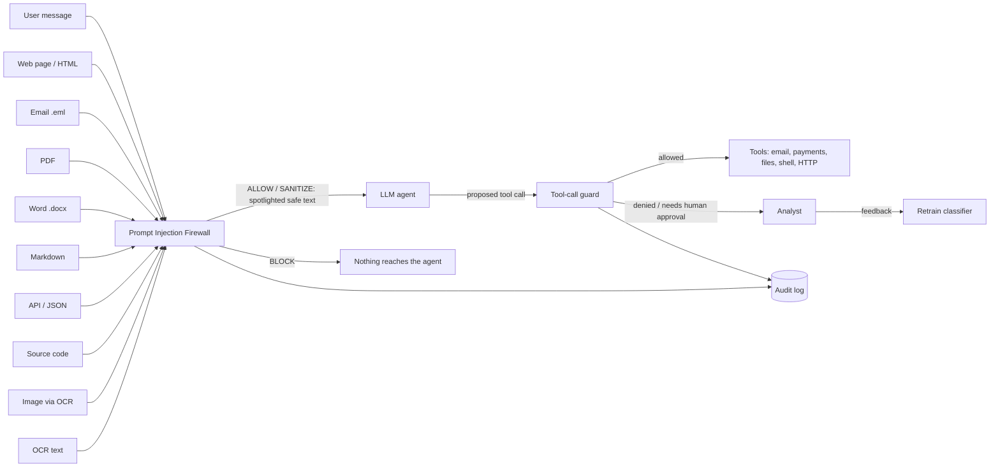
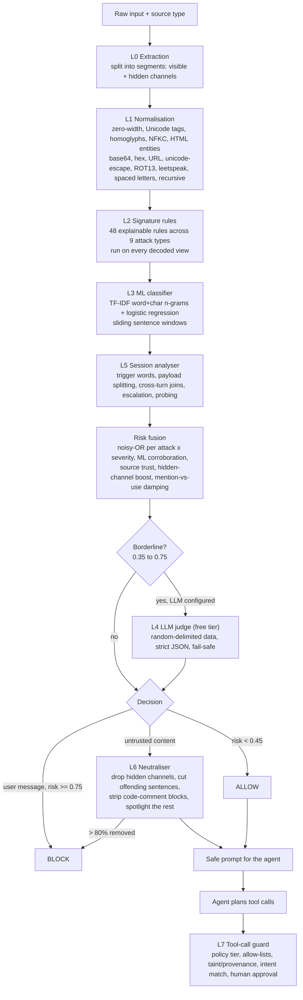

# Prompt Injection Firewall: structural architecture

**Problem 2: Agentic Cybersecurity (Prompt Injection Firewall).**
**Claimed position on the 9-blocker: D3 / F3.**

The firewall sits between every untrusted input and an LLM agent. It finds instructions hidden in eleven kinds of input, explains each one, removes only the malicious parts, and checks the agent's tool calls again before they run. It runs fully offline and free. An optional free-tier LLM judge (Groq, Gemini or a local Ollama) is consulted only on borderline cases.

---

## 1. Where it sits



The firewall defends in two places:

1. **Content-time**, before anything enters the model's context.
2. **Action-time**, before any tool runs.

An injection that slips past the first gate still cannot turn into a harmful action.

## 2. Pipeline (process flow)



### Layer by layer

| Layer | Module | What it does | Key decisions |
|---|---|---|---|
| L0 Extraction | `firewall/extractors.py` | Turns each input into segments, each tagged with a channel and a `hidden` flag. | The core idea: **what a human sees vs. what the LLM reads**. Hidden channels are extracted separately: CSS-hidden/zero-size/off-screen HTML, HTML comments, meta and alt/title attributes, JSON-LD; Markdown comments and `[//]: #` references; PDF white, 1-pt or off-page text, annotations and metadata (pdfplumber colour and size analysis); DOCX hidden, white or tiny runs, comments, headers and properties; email HTML parts and attachments (recursive); every JSON string with its path; code comments, docstrings and string literals; image OCR **plus a contrast-reveal OCR pass** for text a human can't see; image metadata; scanned PDFs fall back to OCR. |
| L1 Normalisation | `firewall/normalize.py` | Produces several "views" of each segment (clean plus every decoded payload). | Rules see what the model would effectively see. Decoding is recursive (base64 inside hex) and bounded at depth 2. |
| L2 Rules | `firewall/rules.py` | 48 regex rules, each mapped to one of the 9 attack types, with a weight and a description. | Deterministic, fast (~2 ms) and explainable. The matched span is reported for highlighting and surgical removal. Soft rules (e.g. "hypothetically") only count when corroborated. |
| L3 ML | `firewall/ml.py` | TF-IDF (word 1–2 grams + char 3–5 grams) with logistic regression, scored over sliding sentence windows. | Catches paraphrases the rules miss. CPU-only, trains in seconds, and retrains from analyst feedback. Short strings are damped. The interface allows a drop-in transformer such as DeBERTa. |
| L4 LLM judge | `firewall/llm_judge.py` | Free-tier LLM classification with strict JSON output. | Called **only in the grey zone**, so free quotas last and latency stays low. The content is wrapped in random delimiters so the judge can't be injected itself. Errors degrade to "no opinion" (fail-safe, never fail-open). |
| L5 Session | `firewall/session.py` | Per-conversation memory: trigger words, variable assignments (payload splitting), joins across the last 3 turns, risk escalation, repeated probing. | Multi-step jailbreaks are invisible to per-message checks. |
| Fusion | `firewall/core.py` | Confidence per attack type is a noisy-OR of its hits, scaled by severity, corroborated by ML, and boosted for hidden channels and untrusted sources. | *Mention vs. use*: quoted examples and security-awareness text ("phishing emails ask you to verify…") are damped to limit false positives. |
| L6 Neutraliser | `firewall/sanitizer.py` | Drops flagged hidden segments and short flagged fields. In long text it cuts only the offending sentences plus any neighbours the ML layer flags. In code it removes whole comment blocks while keeping the code intact. What remains goes into randomised `<untrusted_*>` delimiters with a data-only notice (spotlighting). | Minimal disruption: legitimate content still reaches the agent. |
| L7 Tool guard | `firewall/toolguard.py` | Checks every proposed tool call against its policy tier, a destination allow-list, **taint** (emails or URLs that appeared only in third-party content) and **intent** (did the user ask for this kind of action?). Critical tools require human approval; unknown tools are denied. | Defence in depth: even an undetected injection cannot exfiltrate data or move money. |

### Decision policy

| Source | Risk < 0.45 | 0.45–0.75 | ≥ 0.75 |
|---|---|---|---|
| User message | ALLOW | SANITIZE (strip flagged span) | BLOCK |
| Third-party content (web, email, docs, API, code, images) | ALLOW (spotlighted) | SANITIZE | SANITIZE; BLOCK if more than 80% would be removed |

Thresholds can be changed live in the dashboard sidebar.

## 3. Attack coverage (features: F3)

All **9** attack types are detected and named; F3 requires 7.

| # | Attack | How it is detected |
|---|---|---|
| 1 | Instruction Override | Rules IO-01..08 (ignore/override/new instructions/"from now on"), ML |
| 2 | Role Change | RC-01..07 (persona reassignment, jailbreak modes, elevated identity), ML |
| 3 | Secret Extraction | SE-01..05 (system prompt, "repeat the text above", env/config, prefix forcing), plus an output-side leak guard in the agent |
| 4 | Tool Abuse | TA-01..07 (exfiltration to email/URL, destructive commands, shell payloads, payments, privilege escalation, markdown image beacons), plus **L7 tool guard** at action time |
| 5 | Credential Theft | CT-01..04 (passwords, keys, tokens, OTP, seed phrases, phishing lures, key-shaped strings, credentials in URLs) |
| 6 | Context Poisoning | CP-01..07 (fake chat-template tokens and role turns, memory persistence, fabricated authorisation, fake end-of-data, false policy, answer steering) |
| 7 | Multi-Step Jailbreak | MS-01..06 single-message signals plus the **L5 session analyser** (triggers, payload splitting, cross-turn joins, crescendo, probing) |
| 8 | Encoded Instructions | **L1 decoders**: an injection found only after decoding becomes EN-01, and one disguised with invisible or homoglyph characters becomes EN-02 |
| 9 | Indirect Prompt Injection | Source-aware: any injection in third-party content (II-SRC), stronger in hidden channels, plus rules II-01..04 for text addressed to an AI reader |

**Supporting features** (the second aspect of the feature axis):
- **Observability:** JSONL audit log, an audit dashboard, and a layer-by-layer trace for every verdict.
- **Trainability:** analyst feedback with one-click retraining.
- **Fault tolerance:** any parser failure falls back to raw text, and an LLM failure falls back to offline layers.
- **Configurability:** live thresholds.
- **Integration:** a REST API (`api.py`).
- **Human oversight:** approval queue for critical tools.
- **Explainability:** every finding cites the rule, the channel and the evidence span.

## 4. Depth (D3): heterogeneous multimodal input with measured reliability

- **Input heterogeneity:** 11 source types: user message, web page, HTML, Markdown, PDF (including scanned, via OCR), email (including attachments), DOCX, API/JSON, source code, OCR text, and images. Each type has its own hidden channels.
- **Reliability evidence** (`python -m evaluation.evaluate` → `evaluation/REPORT.md`): 424 held-out samples rendered into **real files** of every format, half the attacks placed in hidden channels. Offline mode, no LLM:

| Precision | Recall | F1 | False-positive rate |
|---|---|---|---|
| 98.6% | 98.3% | 98.4% | 3.0% |

| Format | Detection | Hidden-channel detection |
|---|---|---|
| HTML, PDF, email, DOCX, API, code | 97–100% | 100% |
| Markdown | 93% | 100% |
| Images (OCR) | 86% | 71% (faint text) |

Multi-turn scenarios: 6/6 correct. Tool-guard cases: 6/6 correct. Median latency is 2.3 ms for text and about 5 ms across all formats; image OCR runs at roughly 1–2 s.

**Honest limits.** The evaluation set is synthetic. The ML layer never saw these templates, but the rules were refined while looking at errors on this set, so these are development-set numbers. `evaluation/external_benchmark.py` runs the firewall on any public dataset for an independent estimate. Known weak spots: OCR of long hex strings in images, security-education text that quotes phishing phrasing, and novel paraphrases when the LLM judge is off.

## 5. Model usage

| Model | Where | Why |
|---|---|---|
| Regex signature engine | L2 | Zero-cost, explainable, deterministic baseline |
| TF-IDF + logistic regression (scikit-learn) | L3 | Generalises to paraphrases, CPU-only, retrains in seconds from feedback |
| Tesseract OCR (+ contrast-reveal pass) | L0 | Reads text in images and scanned PDFs, including near-invisible text that vision LLMs would read |
| Free-tier LLM: Groq `llama-3.1-8b-instant`, Gemini `2.0-flash` or Ollama | L4 (grey zone only); optional real-LLM demo agent | Semantic judgement on ambiguous cases, hardened against injection and fail-safe |

## 6. Responsible AI and robustness

- **Hallucination:** the LLM is never the sole decider. It is consulted only in the grey zone, and its output is schema-validated.
- **Security:** the judge is itself hardened with random delimiters and data-only framing. Tool calls are policed by provenance and intent.
- **Privacy:** runs locally with no data leaving the machine unless an LLM provider is configured.
- **Bias and over-blocking:** mention-vs-use damping, sanitising instead of blocking third-party content, and a measured false-positive rate.
- **Human oversight:** approval queue for critical tools, adjustable thresholds, feedback loop.

## 7. Repository map

```
firewall/          core library (extractors, normalize, rules, ml, llm_judge, session, sanitizer, toolguard, core)
agent/             demo victim agent (MailPilot) + 10 poisoned scenarios across all formats
evaluation/        file renderers, evaluation harness, REPORT.md, results.json, external benchmark
app.py             Streamlit dashboard (agent demo, inspector, conversation, evaluation, audit log)
api.py             FastAPI service (/scan, /scan/file, /tool/check, /feedback)
tests/             pytest suite
demo_inputs/       the scenario files, ready to upload
```
